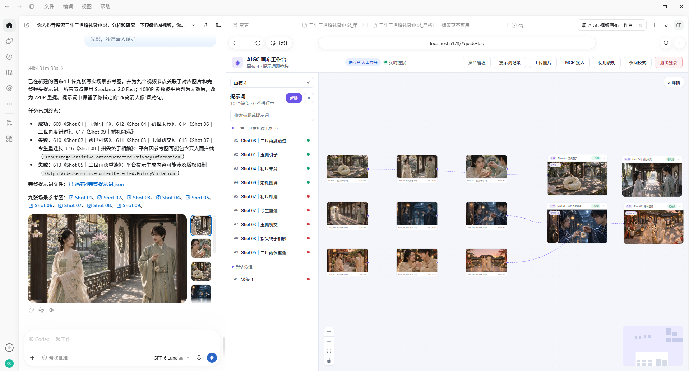
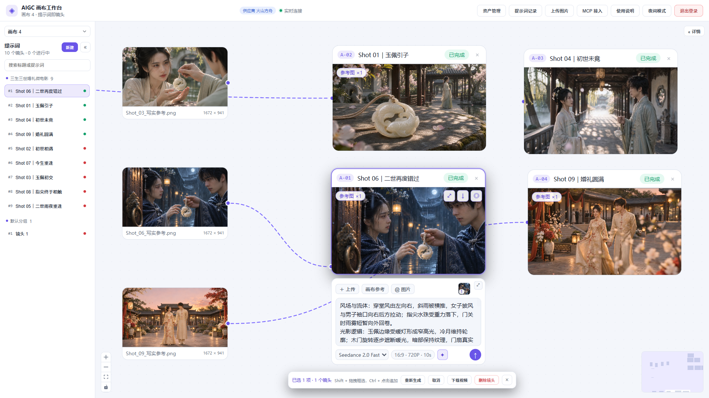

# Agent造剧｜Agent 驱动的视频与漫剧工作台

**Agent造剧**让 Codex、WorkBuddy 等 Agent 不只提供创作建议，还能通过 CLI 直接在项目画布里执行视频与漫剧制作流程。Agent 可以把创意拆成脚本、参考图片和分镜视频任务，提交生成、跟踪进度；创作者则在画布上检查、调整和继续编辑。

以前，创意和分镜写在聊天里，创作者还要手动复制提示词、创建节点、关联参考图，再逐个确认任务状态。现在可以直接告诉 Agent：

```text
帮我制作一集古风漫剧。根据这段故事整理脚本和分镜，准备角色参考图，
把分镜提交为视频生成任务，并把图片与对应镜头关联到同一张画布。
完成后告诉我每个镜头的生成状态和失败原因。
```

Agent 使用项目 CLI 把工作落到真实画布中。你继续决定创作方向、检查生成结果、修改内容并推进下一轮。

## 适合用户

1. 已经使用画布、但想把批量建节点和跟进任务交给 Agent 的创作者。
2. 适合用 Codex、Claude code、WorkBuddy 等工具搭建固定视频工作流的用户。
3. 希望数据私有化、自行扩展第三方API的用户、企业。


## 项目展示

**Agent 从故事创意到漫剧分镜：**



**分镜素材、参考图与生成视频在画布中关联管理：**



## 从 Agent 对话到可编辑画布

项目 CLI 将画布操作提供给能运行本地命令的 Agent。通过 JSON 输出，Agent 可以读取节点 ID、素材与生成状态，并据此继续后续步骤：

- 创建和检查画布，查看当前可用模型与素材。
- 创建脚本节点并调用脚本生成；创建 AI 图片节点、上传参考图或生成图片。
- 批量提交分镜视频任务，把参考图片关联到对应镜头。
- 查询任务进度、读取失败原因，并按需取消或重新生成。
- 将脚本、图片和视频任务保留在可继续编辑的画布中。
  
**完整命令、漫剧工作流示例和任务轮询方式见 [Agent CLI 指南](docs/agent-cli.md)。**
  
CLI 当前负责分镜级素材生成和任务编排；视频剪辑、配音、转场和整集合成仍需其他工具完成。
  


## 功能

- Agent 通过 CLI 自动编排脚本、图片参考、分镜视频生成和任务跟踪。
- 也可通过 MCP 或网页界面创建视频镜头和提示词。
- 使用画布节点组织图片、脚本、文本与视频任务，并连接图片参考。
- 对接兼容的文本、图片和视频模型；未配置模型密钥时可使用 Mock 演示能力。
- 支持素材上传、图片处理、批量选择和下载。
- 默认使用 H2，也支持 MySQL；素材可存储在本地或配置的对象存储中。

## 已接入模型

以下模型已在项目配置中登记。实际可用性取决于对应平台账号权限、API Key 和模型服务开通情况；在环境变量中配置平台密钥后，模型会用于对应的生成能力。

| 平台 | 用途 | 模型（模型 ID） |
| --- | --- | --- |
| 火山方舟 | 文本 | Doubao Seed Evolving（`doubao-seed-evolving`）、Doubao Seed 2.1 Pro（`doubao-seed-2-1-pro-260915`）、Doubao Seed 2.1 Lite（`doubao-seed-2-1-lite-260915`）、DeepSeek V4.1 Flash（`deepseek-v4-1-flash-261017`）、DeepSeek V4.1 Flash Economy（`deepseek-v4-1-flash-economy-261017`）、GLM-5.3 Flash（`glm-5-3-flash-260828`） |
| 火山方舟 | 图片 | Seedream 5.5（`doubao-seedream-5-5-261028`）、Seedream 4.0（`doubao-seedream-4-0-20260415`） |
| 火山方舟 | 视频 | Seedance 2.5（`doubao-seedance-2-5-260628`）、Seedance 2.0（`doubao-seedance-2-0-260128`）、Seedance 2.0 Fast（`doubao-seedance-2-0-fast-260128`） |
| OpenAI | 文本、图片 | GPT-4.1（`gpt-4.1`）、GPT Image 1（`gpt-image-1`） |
| 阿里云百炼 | 文本 | Qwen Plus（`qwen-plus`） |
| Mock 演示 | 文本、图片、视频 | Mock 文本（`mock-text`）、Mock 图片（`mock-image`）、Mock 视频（`mock-video`），无需 API Key，用于演示和本地流程验证 |

## 技术栈

- 后端：Java 17、Spring Boot 3.4、Maven
- 前端：Vue 3、Vite、Vue Flow、Node.js
- 数据库：H2（默认）或 MySQL

## 本地开发

需要安装 JDK 17、Maven 和 Node.js。

启动后端：

```sh
cd server
mvn spring-boot:run
```

启动前端（另开一个终端）：

```sh
cd web
npm ci
npm run dev
```

打开 <http://127.0.0.1:5173>。前端开发服务器会把 `/api`、`/files`、`/mcp` 和 `/ws` 请求代理到本机 8080 端口。

默认配置使用本地 H2 数据库与 Mock 模型。接入实际模型前，请通过环境变量配置管理员凭据、MCP Token 和对应平台的 API Key。不要将个人凭据或 API Key 提交到仓库；公网部署时请使用 HTTPS，并设置独立的高强度 MCP Token。

更多系统设计与部署说明见[架构文档](docs/architecture.md)和[产品设计](docs/product-design.md)。

## MCP

后端 MCP 使用 SSE 传输，默认端点为 `/sse` 和 `/mcp/message`。请求需要通过 `Authorization: Bearer <MCP_API_TOKEN>` 认证。开发环境默认 Token 为 `12345678`，仅供本地使用；部署到可访问的网络前，请设置自己的随机 Token。

当前提供 32 个工具，覆盖画布管理、模型与素材查询、分镜推送与自动排版、生成/重试/取消、参考图上传与连线、AI 图片生成、文本与脚本节点。与 CLI 相比，MCP 不需要登录，也不支持读取客户端本地文件路径；本地图片可改用 `upload_image` 的 base64 内容或可访问的图片 URL。

客户端配置示例：

```json
{
  "mcpServers": {
    "aigc-canvas": {
      "type": "sse",
      "url": "http://localhost:8080/sse",
      "headers": { "Authorization": "Bearer <MCP_API_TOKEN>" }
    }
  }
}
```

完整工具列表、参数和推荐工作流见应用内「系统使用说明 → MCP 接入」页面。

## 作者

[Wonder（`wonder`）](https://github.com/Famine-Life)

## 支持项目

如果这个项目对你有帮助，欢迎通过以下方式支持作者继续维护和改进项目。

**微信支付**

[](docs/images/wechat-donate.jpg)

**支付宝**

[](docs/images/alipay-donate.jpg)


## 许可证

本项目使用 MIT 许可证，允许修改和再发布；再发布时请保留版权和许可证声明。详情见 [LICENSE](LICENSE)。
