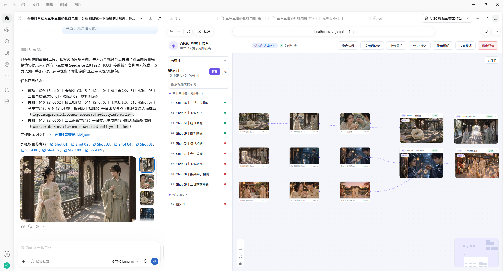
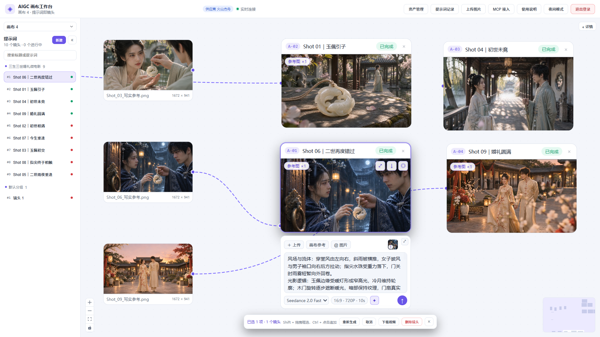

# Agent造剧｜Agent 驱动的视频与漫剧工作台

**TRAE 开发比赛 · 作品说明**

| 项目 | 内容 |
| --- | --- |
| 作品名称 | Agent造剧 |
| 作品形态 | 开源 Web 工作台 + 零依赖 CLI + 可选 MCP |
| 技术栈 | Java 17、Spring Boot 3.4、Vue 3、Vite、Vue Flow、H2 / MySQL |
| 开源协议 | MIT |
| 作者 | Wonder |

---

## 作品速览

**Agent造剧**不是另一个“输入一句话、等待出片”的聊天式视频工具，而是一个让 Agent 真正“动手做剧”的工作台。

它把视频与漫剧制作拆成一条可执行、可追踪的链路：

```text
故事 / 创意
   ↓  Agent 拆解
脚本节点 → 角色与场景参考图 → 分镜 JSON
   ↓  项目 CLI 批量提交
视频生成任务（异步排队、轮询、重试）
   ↓  WebSocket 实时回填
画布上的镜头、参考图、状态与成片
   ↓  创作者检查、调整、继续生成
下一轮迭代
```

在这条链路里，Agent 负责把创意变成结构化任务并推进执行；创作者负责判断方向、检查结果和决定下一轮。画布不是结果展示页，而是整个创作过程的“事实源”。

**核心数据**

| 维度 | 已实现 |
| --- | --- |
| Agent 入口 | 35 个 CLI 子命令，统一 `--json` 输出；可选 3 个 MCP 工具 |
| 画布节点 | 镜头、图片、脚本、文本、分组 5 类节点 |
| 素材关系 | 图片 → 镜头多对多引用，提示词内用 `@图片n` 绑定 |
| 任务状态 | 11 个状态，覆盖本地排队、供应商排队、提交待确认、运行、终态 |
| 模型能力 | 文本、图片、视频 3 类；火山方舟、OpenAI、阿里云百炼、Mock 4 个平台 |
| 存储与部署 | 本地磁盘 / MinIO / 腾讯云 COS / 阿里云 OSS；H2 / MySQL；可选 Redis 多实例 |
| 工程规模 | 88 个 Java 源文件、20 个业务组件、20 份开发任务记录 |

**真实运行截图**



*Agent 在对话中完成一集漫剧的镜头拆解、参考图关联和任务状态汇总；画布同步呈现结果。*



*镜头节点、参考图连线、生成状态、提示词编辑器在同一张画布中组织，创作者可以直接检查和调整。*

---

## 一、作品实现了哪些核心功能

### 1.1 核心功能一：让 Agent 直接“动手”的 CLI 工作流

**它帮助用户完成什么**

用户只需要用自然语言描述目标，例如“帮我制作一集古风漫剧，整理脚本和分镜，准备角色参考图，把分镜提交为视频任务，并告诉我每个镜头的状态”，Agent 就可以通过项目 CLI 完成从脚本、参考图、分镜到视频任务的整条链路，而不只是给出一段建议。

**实现方式**

- `cli/aigc.mjs` 是零依赖的 Node.js 命令行客户端，只使用 Node 16+ 内置模块，不需要安装任何 npm 包。
- 覆盖 35 个子命令，分为会话、画布、模型、素材、脚本、图片、镜头、分镜、任务、连线等类别，例如：

```sh
node cli/aigc.mjs login --username "你的账号" --password "你的密码"
node cli/aigc.mjs canvas --json
node cli/aigc.mjs models --json
node cli/aigc.mjs storyboard --file shots.json --group "漫剧-第1集" --json
node cli/aigc.mjs canvas --json
```

- 所有读写命令支持 `--json`，返回稳定的原始 JSON，Agent 可以直接解析任务 ID、图片 ID、状态和失败原因。
- 登录态保存在用户主目录的 `~/.aigc-cli/session.json`，复用网页的 Session 鉴权；写操作自动请求 CSRF Token 并携带 `X-XSRF-TOKEN`。
- `upload` 命令手写 multipart 请求体，兼容 Node 16 没有全局 `FormData` / `fetch` 的环境。
- CLI 不依赖 MCP，也不额外扩大权限；它调用的是与网页相同的 REST 接口，REST 是唯一事实源。

**相比原有方式**

以前，创意和分镜写在聊天里，创作者还要手动复制提示词、在画布上逐个建节点、上传参考图、把图片连到对应镜头，再反复刷新任务状态。一个 10 镜头的分镜，意味着几十次重复操作和大量上下文切换。

现在，Agent 可以一次性读取画布和模型列表、创建脚本节点、生成或上传参考图、批量提交分镜、轮询任务，并在终态后汇总每个镜头的状态。创作者只需要在画布上检查结果、调整不满意的镜头。

**带来的改进**

- **效率**：把“每个镜头一组手动操作”变成“一条指令驱动一批任务”；批量分镜、批量上传、批量查询都可以由 Agent 完成。
- **体验**：Agent 不只说“完成了”，而是能返回任务 ID、镜头标题、当前状态和失败原因；创作者可以在画布上直接定位到具体镜头。
- **成本**：CLI 不需要额外服务或依赖；登录态复用现有鉴权；幂等键避免同一提示词重复创建任务，减少重复生成带来的费用。

**真实效果**

截图中的一集漫剧包含 10 个镜头和 10 张参考图。Agent 在对话中汇总了成功任务，并明确指出失败镜头是因为平台内容限制（`OutputVideoSensitiveContentDetected.PolicyViolation`）未通过，而不是笼统地报告“生成失败”。这让创作者可以针对具体镜头调整提示词或素材，而不是从头重来。

---

### 1.2 核心功能二：可编辑、可追踪的画布

**它帮助用户完成什么**

画布把“聊天里的创意”变成“看得见、改得动、能继续迭代的创作现场”。用户可以在一张画布上组织一集甚至多集内容，检查镜头、参考图和生成结果之间的关系。

**实现方式**

- 5 类节点：镜头（视频任务）、图片（参考图 / AI 图片）、脚本、文本、分组。
- 画布空白处右键可创建文本、脚本、图片、视频等节点；支持拖拽、粘贴剪贴板图片、拖入本地图片。
- 图片节点与镜头节点之间是多对多引用：同一张图可以连多个镜头，一个镜头也可以接多张图；提示词里用 `@图片1`、`@图片2` 按连线顺序引用。
- 支持 `Shift + 拖拽` 框选、`Ctrl / ⌘ + 点击` 追加选择，底部浮动工具条可批量重新生成、取消、删除。
- 支持 `Ctrl / ⌘ + D` 复制节点、`Alt + 拖动` 在落点复制、`Backspace / Delete` 删除，输入框内不会误触发快捷键。
- 画布坐标、视口和节点位置保存在快照中；多标签页或多实例保存冲突时返回 409，前端提示并同步最新布局，而不是静默覆盖。
- WebSocket 实时回填任务状态；断线后按 1/2/4/8 秒指数退避重连，重连成功后补拉画布状态。
- 支持多画布新建、复制、重命名、删除，方便按剧集或项目组织内容。

**相比原有方式**

以前，提示词在聊天记录里，参考图在文件夹里，任务状态在另一个标签页里，成片下载后又散落在本地。创作者很难回答“这个镜头用了哪张参考图”“这张图还关联了哪些镜头”“上次失败的是哪一条”。

现在，节点、连线、提示词、参数、状态和成片都在同一张画布上；删除图片会级联清理引用连线，但已经生成的成片不受影响；删除镜头前有二次确认，未完成任务会先取消。

**带来的改进**

- **效率**：框选、批量操作、快捷键和整卡连线减少了大量重复点击；同一张参考图可以复用到多个镜头。
- **体验**：创作者的注意力从“找文件、对编号、刷新页面”回到“看画面、判断内容、决定下一轮”。
- **成本**：参考图与镜头的引用关系明确，减少因为图片传错、编号错位导致的无效生成；批量下载减少逐条保存的时间。

---

### 1.3 核心功能三：异步任务编排与 11 状态可视化

**它帮助用户完成什么**

视频生成通常需要几十秒到几分钟，且平台会限流、排队、偶发失败。这个功能让用户提交任务后可以离开页面，回来时能看到每个任务真实处于哪个阶段，失败时知道原因，并能原地重试。

**实现方式**

- 一条提示词对应一个视频任务，异步提交、异步轮询；调度器默认每 800ms 扫描一次队列。
- 任务状态不止“生成中”，而是拆成 11 个状态：`RECEIVED`、`QUEUED`、`SUBMITTING`、`SUBMITTED`、`PROVIDER_QUEUED`、`RUNNING`、`SUBMIT_UNKNOWN`、`SUCCEEDED`、`FAILED`、`TIMEOUT`、`CANCELED`。
- 轮询采用 2/3/5/8/13/20/30 秒退避，避免高频请求；单任务默认 900 秒超时。
- 幂等键为 `sha256(workspaceId | groupId | shotIndex | prompt)`，同一提示词重复推送只产生一个节点。
- 提交使用 CAS 抢占，避免多线程或多实例重复提交；供应商任务号唯一，避免轮询错任务。
- 遇到 429 时遵循 `Retry-After` 退避；网络超时或 5xx 不盲目重提，而是进入 `SUBMIT_UNKNOWN`，提示用户先核对供应商控制台。
- 生成成功后立即把第三方视频转存到自有存储，避免供应商 URL 过期；同一源 URL 做内存缓存，避免重复下载。
- 前端通过 `node.created`、`node.progress`、`node.completed`、`node.failed` 等 WebSocket 事件实时更新。

**相比原有方式**

以前，用户提交后只能反复刷新页面，看到“生成中”却不知道是本地排队、平台排队还是真的在生成；失败后往往直接重新提交，可能产生重复任务和重复费用；第三方视频链接过期后还会出现“昨天还能看，今天打不开”。

现在，任务状态分层可见，失败原因回传，重试保持原节点 ID、分组、镜号、坐标不变；成片转存后由自有存储提供访问。

**带来的改进**

- **效率**：提交、轮询、退避、重试由系统完成，用户不需要守着页面。
- **体验**：能区分“本地排队”“供应商排队”“提交待确认”，减少误判；失败镜头原地重试，不丢上下文。
- **成本**：幂等和 CAS 避免重复任务；不确定提交不自动重提，避免重复扣费；成片转存避免因链接过期而重新生成。

---

### 1.4 核心功能四：多平台模型接入与内置 AI 创作

**它帮助用户完成什么**

用户可以在同一个工作台里选择不同的文本、图片、视频模型，完成脚本生成、参考图生成、提示词优化和视频生成，而不需要在多个平台之间复制粘贴。

**实现方式**

- 平台与模型解耦：平台只声明 `base-url`、`api-key` 和协议能力；模型声明自己支持文本、图片还是视频，以及比例、清晰度、时长等参数范围。
- 统一用 `provider/model` 引用模型，例如 `ark/doubao-seedance-2-0-260128`、`openai/gpt-4.1`、`dashscope/qwen-plus`。
- 未配置 `api-key` 的平台不会出现在 `/api/meta` 和前端下拉中；全部未配置时自动回落到 Mock，8 秒演示出片，不需要任何密钥。
- 内置 AI 能力：
  - 脚本节点：根据主题、风格生成分镜列表，可单条或批量加入画布。
  - 图片节点：文生图，生成结果直接成为画布图片节点，可继续作为视频参考图。
  - 提示词优化：一键优化镜头提示词，结果可复制、重新生成或填充到输入框，填充不会自动提交。
- 镜头节点下方内联提示词编辑器支持模型、比例、清晰度、时长选择；参数按所选模型的白名单校验，非法值回退默认值。
- 修改参数时默认 `regenerate=false`，只保存参数、不消耗生成次数；点击发送才重新生成。

**相比原有方式**

以前，模型 ID 和供应商逻辑硬编码在前后端，新增一个平台往往要改配置结构、任务表和前端下拉；脚本、图片、提示词优化则要在不同工具之间来回切换。

现在，新增平台优先改配置即可；模型下拉按平台分组；参数范围由模型自己声明，前端不再维护一份硬编码列表。

**带来的改进**

- **效率**：接入新平台从“改代码 + 改前端 + 改文档”变成“补一段平台配置”；模型切换在画布和 CLI 中都能完成。
- **体验**：脚本、图片、视频在同一个画布中流转，提示词、参考图和生成参数不丢上下文。
- **成本**：可以按任务选择更经济的模型；Mock 模式让演示和本地流程验证不需要 API Key；参数校验减少因不支持的比例 / 清晰度导致的失败生成。

---

### 1.5 核心功能五：可私有化的安全部署

**它帮助用户完成什么**

让个人创作者、小团队或企业可以把整套工作台部署在自己的服务器上，用自己申请的平台密钥生成内容，画布和素材不暴露给无关人员。

**实现方式**

- 网页使用账号密码登录，密码在服务端通过 BCrypt 校验，登录后使用 `AIGCSESSION` Cookie（HttpOnly、SameSite=Strict）。
- 写操作要求 `X-XSRF-TOKEN`，未登录返回 401，未通过 CSRF 返回 403。
- MCP 的 `/sse` 与 `/mcp/message` 使用独立的 `Authorization: Bearer <MCP_API_TOKEN>`，网页 Session 不能替代；Token 使用常量时间比较。
- WebSocket 握手和 `/files/**` 本地媒体同样要求有效 Session，默认仅允许同源。
- 对象存储支持本地磁盘、MinIO、腾讯云 COS、阿里云 OSS；云端桶保持私有，响应阶段生成短期 GET 签名 URL，数据库只保存稳定 URL。
- 默认单机零依赖：H2 文件库 + 本地存储 + 内存广播即可完整运行；需要多实例时，通过配置开启 Redis Pub/Sub、调度分布式锁和 Redis Session。
- 管理员密码、MCP Token、平台 API Key 全部通过环境变量或本地私有配置注入，不写入仓库、不下发前端。

**相比原有方式**

以前，画布、REST、WebSocket 和媒体文件可以匿名访问，部署到公网后存在数据泄露和被他人操作的风险；对象存储常用公共读，链接一旦泄露就很难收回。

现在，未登录只能看到登录页；网页与 MCP 使用相互独立的凭证；素材默认私有，访问地址有有效期；单机可以零依赖运行，多实例再按需开启 Redis。

**带来的改进**

- **效率**：本地启动只需要 JDK 17、Maven 和 Node.js；不配置任何模型密钥也能用 Mock 跑通完整流程。
- **体验**：登录门禁、私有素材、签名访问让创作者可以放心把工作台放到公网。
- **成本**：不依赖 SaaS 订阅，使用自己的平台账号和存储；单机默认不引入 Redis、MQ、Docker，降低部署和维护成本。

---

### 1.6 其他已实现能力

- **多画布管理**：新建、复制、重命名、删除画布，按剧集或项目组织内容。
- **图片处理**：在画布内框选裁剪、九宫格切分，处理结果直接成为新的图片节点。
- **视频截帧**：从生成视频中截取当前帧、首帧或尾帧，直接作为新的参考图节点。
- **资产管理**：统一查看生成视频、AI 图片、上传图片，支持预览、下载和批量下载。
- **提示词记录**：每次提交或修改提示词都写入 `prompt_record`，顶栏可查看最近 200 条记录，方便回溯。
- **使用说明页**：内置快速开始、MCP 接入、CLI 使用和常见问题，降低新用户上手成本。
- **主题与画布体验**：白天 / 夜间主题切换、节点缩放上限、侧栏折叠为图标栏、检查器收起与记忆。

---

### 1.7 亮点总结

1. **Agent-native，而不是“AI 辅助”**：Agent 不只是给建议，而是通过 CLI 真正创建节点、提交任务、读取状态、汇报失败原因。
2. **画布是事实源**：脚本、参考图、分镜、参数、状态和成片都在同一张可编辑画布上，创作过程可追溯、可继续。
3. **可靠性优先**：幂等键、CAS、11 状态机、提交待确认、429 退避、有界队列，都是为了让“批量生成”在真实平台限流下仍然可控。
4. **成本可控**：Mock 零密钥演示、按模型选择参数、参数保存不消耗生成次数、幂等避免重复任务、成片转存避免重复生成。
5. **可私有化**：单机零依赖即可运行，也可以按需升级到 MySQL、Redis、MinIO / COS / OSS，数据和使用自己的平台密钥。

---

## 二、TRAE 在开发过程中提供了哪些具体帮助

我在这个项目里不是让 TRAE “一键生成一个项目”，而是把它当成一个能读仓库、能改多处关联文件、能跑构建和验证的结对工程师。

我的固定做法是：先给出问题、约束和验收标准；让 TRAE 先读相关代码；再让它给出改动；最后必须跑构建、测试或浏览器验证，并把结果写进 `docs/task-records/`。下面选取四个对作品有实际贡献的开发任务。

### 2.1 案例一：把“MCP 能做什么”延伸为“Agent 能稳定做什么”

**当时需要解决的问题**

项目早期已经通过 MCP SSE 让 AI 客户端推送提示词，但在真实使用中，Agent 需要的是一个稳定、可脚本化、能读回结果的本地接口。MCP 受客户端兼容性和会话粘滞影响；Agent 还要处理登录、CSRF、图片上传和任务轮询。

**我做出的判断**

- 不新造一套协议，REST 继续作为唯一事实源。
- CLI 是 Agent 的适配层，不是第二套后端。
- 零依赖，避免创作者为了用 CLI 再装一堆 npm 包。
- 所有读写命令提供 `--json`，让 Agent 能稳定解析。
- 登录态沿用网页 Session，写操作自动处理 CSRF；不把 MCP Token 交给 CLI。

**TRAE 具体协助完成了什么**

- 先阅读现有 REST、鉴权和上传接口，确认哪些能力可以复用。
- 实现 35 个子命令，包括 `login`、`canvas`、`models`、`assets`、`push`、`storyboard`、`upload`、`create-node`、`generate-script`、`generate-image`、`link-image`、`retry`、`cancel` 等。
- 手写 multipart 请求体，兼容 Node 16 没有全局 `FormData` / `fetch` 的环境。
- 处理 Cookie 保存、CSRF Token 刷新、401 重新登录提示和 `--json` 原始输出。
- 用真实服务验证了登录、画布查询、推送镜头、上传图片、删除节点等命令。
- 同步更新架构文档的 CLI 章节和使用说明页。

**最终如何体现在作品中**

`cli/aigc.mjs` 成为 Agent 的主入口，README 和 `docs/agent-cli.md` 中的漫剧工作流都基于它；截图中的 Agent 能完成“脚本 → 参考图 → 分镜 → 状态汇总”的闭环。

---

### 2.2 案例二：多平台模型接入重构

**当时需要解决的问题**

原有配置按“供应商”分组，文本、图片、视频各自维护，接入的都是字节体系、共用同一个 `base-url`。视频还把 `seedance` / `seedance-fast` 当作模型 ID 硬编码在前端和任务表里。后续要接阿里云百炼、OpenAI，继续这样改会越来越难维护。

**我做出的判断**

- 平台与模型解耦：平台只管地址、密钥和协议；模型声明能力与参数范围。
- 统一用 `provider/model` 复合标识，文本、图片、视频共用同一套结构。
- 未配置 `api-key` 的平台不出现；全部未配置时回落到 Mock。
- 兼容存量任务，旧 `provider=seedance` / `seedance-fast` 自动映射到方舟模型。

**TRAE 具体协助完成了什么**

- 重写 `AiProperties`，删除旧的 `ProviderProperties`，把配置统一到 `aigc.ai`。
- 新增 `ModelRef` 和 `ModelCatalog`，支持默认模型解析、复合 / 裸模型 ID、旧别名、未启用平台过滤和能力参数校验。
- 新增 `ArkVideoProvider`，把视频提交、轮询、取消统一到 `VideoContext`；`ProviderRegistry` 按协议注册。
- 修改 `TaskService`，让比例、清晰度、时长按所选模型的白名单校验与兜底。
- 更新 `/api/meta` 和前端模型下拉，按平台分组展示；脚本节点、图片节点、镜头节点不再硬编码模型。
- 新增 `ModelCatalogTest`，覆盖默认解析、复合 / 裸模型、未启用平台、旧别名和能力参数。
- 跑通后端测试、Maven 打包和前端 `npm run build`，并验证 `/api/meta` 返回的模型清单与可见性过滤。

**最终如何体现在作品中**

现在新增平台优先改配置即可；模型下拉按平台分组；不同模型的比例、清晰度、时长范围由模型自己声明；旧任务仍能继续轮询和展示。

---

### 2.3 案例三：公网安全改造与 CSRF 403 排查

**当时需要解决的问题**

项目部署到公网后，原先匿名可访问的 MCP、REST、WebSocket 和本地媒体文件会带来画布数据泄露和被他人操作的风险；对象存储还依赖永久公共读。

**我做出的判断**

- 采用单管理员、单租户模型，不引入用户注册和复杂角色权限。
- 网页与 MCP 使用相互独立的凭证：网页 Session + CSRF，MCP 独立 Bearer Token。
- 默认仅同源访问，前后端分离部署时才显式配置来源白名单。
- 对象存储保持私有，响应阶段生成短期签名 URL，数据库不保存签名参数。
- 管理员密码和 MCP Token 只通过环境变量配置，无默认密钥。

**TRAE 具体协助完成了什么**

- 接入 Spring Security，完成 BCrypt 单管理员、Session、登录 / 登出、统一 401 / 403 和 CSRF 配置。
- 新增 `McpAuthenticationFilter`，只过滤 `/sse` 和 `/mcp/message`，使用常量时间比较 Bearer Token。
- 新增 `AuthGate.vue`，登录成功后才挂载画布，避免登录前初始化 REST / WebSocket。
- 修改 Axios 封装，自动携带 Session Cookie 和 `X-XSRF-TOKEN`；处理业务 401 通知登录门禁。
- 收紧 CORS 和 WebSocket Origin；本地 `/files/**` 纳入认证保护。
- 为 MinIO、COS、OSS 增加私有上传和短期 GET 签名 URL，数据库仍保存稳定 URL。
- 排查并修复登录初期反复出现的 CSRF 403：根因是 Spring Security 6 默认的 XOR Token 处理与 Axios 回传原始 Cookie Token 不兼容，改用 `CsrfTokenRequestAttributeHandler` 后解决。
- 跑了 14 项安全集成检查，包括匿名 401、未登录读文件 401、未登录握手 WebSocket 401、无 Token 访问 MCP 401、错误 Token 401、无 CSRF 写请求 403、登录后画布 200、登出后再次访问 401 等。

**最终如何体现在作品中**

登录门禁、MCP 独立 Token、私有对象存储和签名 URL 都进入了最终代码；架构文档补充了认证模型、HTTPS / WSS 和反向代理部署说明。作品因此可以从本地演示走到公网部署。

---

### 2.4 案例四：并发与队列保护

**当时需要解决的问题**

真实调用火山方舟时遇到 `429 RequestBurstTooFast`；供应商已经接收但仍在排队的任务被显示成“运行中”；提交错误会直接失败；图片生成线程池使用无界队列；网络中断时无法判断供应商是否已经接收任务，盲目重试可能重复生成、重复扣费。

**我做出的判断**

- 在本地做准入控制：按 provider / model / 清晰度统计在途任务，超过本地闸门就保留在 `QUEUED`，不调用供应商。
- 区分本地排队、供应商排队、实际运行和提交待确认，不能都用“生成中”表示。
- 提交结果不确定时不自动重提，进入 `SUBMIT_UNKNOWN`，提示用户先核对供应商控制台。
- 429 遵循 `Retry-After` 退避；持续限流达到上限后转失败，避免无限重试。
- 图片生成改为固定工作线程 + 有界队列；队列满时返回 429，而不是无限堆积。

**TRAE 具体协助完成了什么**

- 修改 `TaskDispatcher`，按模型和 4K / 非 4K 统计在途任务；只在容量允许时提交；提交前用 CAS 抢占 `QUEUED → SUBMITTING`。
- 新增 `SUBMITTING`、`PROVIDER_QUEUED`、`SUBMIT_UNKNOWN` 状态，并映射方舟的排队状态。
- 实现 429 的 `Retry-After` 退避、最大自动重试次数和 `SUBMIT_UNKNOWN` 恢复逻辑。
- 新增 `TooManyRequestsException`，本地待提交队列满时返回 HTTP 429。
- 把图片生成改为有界工作队列，队列满时标记失败并返回 429。
- 前端区分本地排队、供应商排队、提交待确认和图片本地排队；对 `SUBMIT_UNKNOWN` 增加“先核对平台控制台”的提示。
- 增加 `AIGC_ACCOUNT_TYPE` 等配置，默认企业账号，普通视频并发 10、4K 并发 1；个人账号普通视频并发 3。
- 跑通后端打包和前端构建，并把火山方舟的并发口径整理成 `docs/volcengine-api-concurrency.md`。

**最终如何体现在作品中**

任务状态更真实，队列更可控，平台限流时有序退避，提交结果不确定时不会悄悄重复生成。这部分是作品从“能演示”走向“能真实使用”的关键。

---

### 2.5 其他由 TRAE 协助完成的工作

| 工作 | 解决的问题 | 最终体现 |
| --- | --- | --- |
| 画布多选与批量执行 | 用户希望多个镜头同时执行，但前端只能单选 | `Shift` 框选、`Ctrl / ⌘` 追加、底部浮动工具条、批量重试 / 取消 / 删除 |
| 节点快捷键与事故恢复 | 需要复制、拖动复制、删除节点 | `Ctrl / ⌘ + D`、`Alt + 拖动`、`Backspace / Delete`，并留下事故复盘记录 |
| 提示词记录 | 提示词提交后无处回溯 | `prompt_record` 表、最近 200 条记录、顶栏查看与复制 |
| 资产管理 | 成片、AI 图片、上传图片散落 | 统一资产弹窗，支持分类、预览、下载和批量下载 |
| 图片处理与视频截帧 | 创作者需要裁剪、切分、截帧做参考图 | 框选裁剪、九宫格切分、当前帧 / 首帧 / 尾帧截取 |
| 多画布 | 一集一张画布不够用 | 新建、复制、重命名、删除画布 |
| 使用说明页 | 新用户不知道 MCP / CLI 怎么用 | 快速开始、MCP 接入、CLI 使用、常见问题 |
| 文档与任务记录 | 改动缺少动机和验证证据 | 20 份 `docs/task-records/` 记录，包含需求、改动、验证、影响和遗留 |
| 构建与测试 | 多端改动容易互相破坏 | 后端 `mvn package`、前端 `npm run build`、模型目录 / 提示词记录 / 存储等单元测试 |

### 2.6 小结

TRAE 对这个作品的实际贡献，不是替我决定“做什么”，而是把我做出的产品判断快速变成可运行、可验证、可追溯的代码：

- 我说“Agent 需要一个稳定入口”，它帮我把 CLI 从命令解析、登录态、CSRF、multipart 到 JSON 输出完整落地。
- 我说“平台要可扩展”，它帮我把硬编码的供应商逻辑拆成平台、模型目录和协议适配器。
- 我说“要能公网部署”，它帮我把 Session、CSRF、MCP Token、对象存储签名和 14 项安全验证补齐。
- 我说“批量生成不能重复扣费”，它帮我把并发闸门、CAS、429 退避和提交待确认状态做进任务状态机。

这些工作最终都体现在作品中，而不是停留在对话里。

---

## 三、创作过程中印象最深的经历

### 3.1 背景

2026 年 11 月 14 日，我在做节点快捷键的最后一项验收：`Alt + 拖动` 复制节点。

当时画布里是真实生成的数据，不是测试假数据。项目的 H2 文件库没有可以一键回滚的历史快照。浏览器自动化工具不支持“按住修饰键拖拽”，为了验证落点逻辑，我让测试脚本直接修改 Vue 的内部状态来模拟拖拽。

结果，脚本误删了 `task 3`（`A-03 脚步特写`）和它的 3 条连线。

### 3.2 我承担的角色与当时的处境

我是这个项目唯一的开发者，同时承担产品、前端、后端和验证。那一刻我面对的不是一个普通报错，而是一个很现实的问题：画布上的真实创作数据被我自己的自动化操作弄丢了。

我先停掉了所有自动化写操作，确认损失范围：被删的是 1 个任务和它的 3 条连线；重建后画布恢复为 5 个任务、4 张图片、7 条连线、1 个文本节点。然后判断这是测试脚本的副作用，不是产品逻辑本身的缺陷；但如果我继续用“直接改内部状态”的方式做验证，类似的事故还会再发生。

### 3.3 最难的一环

最难的不是把节点重新建出来，而是**在不可逆的损失面前保持冷静，并把能恢复的信息一条条找回来**。

原 `task 3` 的 ID 不能复用，原视频文件也已经无法找回。我只能从历史命令日志里逐条还原：

- 分组：`A组`
- 标题：`A-03 脚步特写`
- 提示词：`特写：脚踝被浪花打湿，浅景深`
- 参数：`mock / 16:9 / 5s / 720P`
- 连线：`image-66`、`image-65`、`image-129`

我把这些字段重新建成 `task 353`，用 mock 重新生成视频；节点坐标回落到自动布局，原视频无法找回。这是这次事故真实的代价。

### 3.4 我采取的行动

- 立即停止所有会修改画布数据的自动化操作，先确认损失范围，再决定恢复方案。
- 从历史命令日志还原任务字段、参考图 ID、分组和参数，逐项核对后重建节点。
- 把事故经过、恢复过程、丢失内容和遗留问题完整写进 `docs/task-records/2026-11-14-节点快捷键.md`，包括“`Alt + 拖动` 未能自动化验证，需人工确认”这一条。
- 重新检查画布状态，确认恢复后没有影响其他任务和连线。
- 把这次教训变成后续的开发规则：
  - 每次代码、配置或文档改动，都在 `docs/task-records/` 留下任务记录，写清需求、改动、验证、影响和遗留。
  - 自动化验证优先走真实 API 或浏览器交互，不直接修改框架内部状态。
  - 删除和批量操作保留二次确认、级联清理和成功 / 失败汇总。
  - 任务系统增加幂等键、CAS、`SUBMIT_UNKNOWN`，避免“不确定时自动重提”造成不可逆的重复生成。
  - 做破坏性验证前先确认数据可恢复；产品里用画布快照和版本号乐观锁降低覆盖风险。

### 3.5 结果

画布恢复可用，产品继续迭代；损失了一条原视频，但换来了一套可追溯的开发纪律。

今天仓库里的 20 份任务记录、每次改动后的构建验证、对“提交结果不确定”的谨慎处理，都和这次事故有关。它让我从“功能跑通就好”转向“可恢复、可追溯、可验证”。

### 3.6 这件事留下的东西

如果评委问我最大的特点是什么，我会说：**我愿意把事故写进文档，因为能被复盘的事故才会变成能力。**

这次经历也改变了我对 Agent 自动化的理解。Agent 最大的风险不是“不会做”，而是“做错了以后不可逆”。所以在这个作品里，我不仅让 Agent 能执行，还给它加了边界：幂等、状态机、确认、失败原因、可回滚的画布快照。让 Agent 能做事，也让创作者能放心地让它做事，这是我做这个作品时最在意的事。

---

## 附：可核验的实现与记录

| 内容 | 位置 |
| --- | --- |
| Agent CLI 实现 | [cli/aigc.mjs](../cli/aigc.mjs) |
| CLI 使用指南 | [docs/agent-cli.md](agent-cli.md) |
| 系统架构设计 | [docs/architecture.md](architecture.md) |
| 产品设计 | [docs/product-design.md](product-design.md) |
| 安全改造记录 | [docs/task-records/2026-11-14-公网单租户安全访问.md](task-records/2026-11-14-公网单租户安全访问.md) |
| 多平台模型重构记录 | [docs/task-records/2026-11-15-多平台模型接入重构.md](task-records/2026-11-15-多平台模型接入重构.md) |
| 并发与队列保护记录 | [docs/task-records/2026-11-16-生成任务并发与队列保护.md](task-records/2026-11-16-生成任务并发与队列保护.md) |
| 多实例部署记录 | [docs/task-records/2026-11-14-多实例部署支持.md](task-records/2026-11-14-多实例部署支持.md) |
| 节点快捷键与事故复盘 | [docs/task-records/2026-11-14-节点快捷键.md](task-records/2026-11-14-节点快捷键.md) |
| 火山方舟并发说明 | [docs/volcengine-api-concurrency.md](volcengine-api-concurrency.md) |
| Agent 工作流截图 | [docs/images/agent-storyboard-workflow.png](images/agent-storyboard-workflow.png) |
| 画布展示截图 | [docs/images/storyboard-canvas-showcase.png](images/storyboard-canvas-showcase.png) |

**本地体验**

```sh
# 后端
cd server
mvn spring-boot:run

# 前端（另开一个终端）
cd web
npm ci
npm run dev
```

打开 `http://127.0.0.1:5173`。不配置任何模型密钥时，系统使用 Mock 模型，8 秒左右出片，可以完整体验“推送 → 节点 → 进度 → 播放”的流程。
